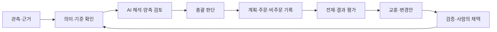

# SION Ontology

**관측에 뜻을 붙이고, 판단을 실행과 결과까지 연결합니다.**

SION 온톨로지는 투자 판단의 근거·해석·전제·행동을 연결하는 구조입니다. AI가 어떤 자료를 받아 무엇을 주장했고, 어떤 반론을 검토해 결론을 내렸으며, 실제로 무엇을 했는지 따라갈 수 있게 합니다.

## 핵심 개념: 같은 자료를 같은 뜻으로 판단하기

가격과 뉴스를 모으는 것만으로 판단의 근거가 명확해지지는 않습니다.

| 판단에서 생기는 문제 | 온톨로지에서 다루는 방법 |
|---|---|
| 같은 숫자를 서로 다른 의미로 해석 | 대상·단위·기간·출처·시각과 공통 정의를 연결 |
| 사실 확인과 투자 전망을 혼동 | 관측 사실·인용·AI 가설을 구분 |
| 반론을 읽었는지, 실제로 반영했는지 불명확 | 평가별 채택·기각·유보·미검토 상태와 이유를 기록 |
| 판단과 주문, 사후 결과가 따로 남음 | 판단 → 계획 → 실행 → 전제 평가를 연결 |

## 무엇을 연결하는가

| 구성 | 연결하는 내용 | 확인할 수 있는 질문 |
|---|---|---|
| **관측과 근거** | 종목, 판단 회차, 가격·수급, 출처와 전달 자료 | 당시 AI가 실제로 받은 자료는 무엇인가? |
| **의미와 기준** | 측정값의 뜻, 기준 버전, 계산·판정 결과 | 이 값은 무엇을 뜻하며 어떤 기준으로 평가됐는가? |
| **주장과 판단** | 사실 주장, 가설, 인과 경로, 양측 평가와 총괄의 채택 | 어떤 해석과 반론이 최종 판단에 반영됐는가? |
| **전제와 실행** | 종목별 전제, 수량 계획, 주문·체결, 관망·보유 기록 | 무엇을 기대했고 어떤 행동으로 이어졌는가? |
| **평가와 개선** | 전제 평가, 비교 사례, 교훈·변경안, 검증과 채택 | 무엇이 틀렸고 다음 판단에 무엇을 바꿀 것인가? |

## 판단 흐름

### 한 번의 판단

| 순서 | 역할 | 남기는 내용 |
|---|---|---|
| 1 | **해석 — Interpretation** | 관측의 의미, 사실과 가설, 주장으로 연결한 인과 경로 |
| 2 | **찬성 검토 — Bull** | 각 경로의 지지 근거, 가정·불확실성, 추가 반론 |
| 3 | **반대 검토 — Bear** | 선행 주장과 경로에 대한 반대 평가, 대안 해석과 반론 |
| 4 | **총괄 판단 — Lead** | 평가·반론의 처리 상태, 채택한 주장, 확신도와 행동 |

각 역할은 별도 호출로 실행됩니다. 서버가 공통 정의·실효 기준·수락된 선행 결과를 다음 단계의 입력으로 구성하고 보존합니다. 필수 단계가 빠지거나 입력·결과를 보존하지 못하면 다음 단계로 진행하지 않습니다.

### AI와 코드의 역할

| AI가 판단하는 것 | 코드가 확인·처리하는 것 |
|---|---|
| 관측을 투자 전망으로 해석하고 가설 제시 | 인용한 값·단위·대상과 제출한 측정 맥락을 전달 자료에 대조 |
| 경로의 근거·가정·불확실성과 반론 평가 | 선행 단계, 참조 관계, 필수 평가의 제출 여부 검사 |
| 평가를 채택·기각·유보하고 확신도 선택 | 선택한 구간의 조건과 채택 기록의 일치 여부 검사 |
| 매수·매도·보유·관망 판단 | 수락된 판단을 기존 수량 계산·리스크 검사·실행에 연결 |

## 의미를 구분하는 방법

| 자료 | 구분하는 의미 |
|---|---|
| **가격** | 장중 현재가와 일별 종가 |
| **수급** | 장중 추정값과 일별 순매수액, 기간 합계와 매일의 방향 |
| **점수** | 후보 모집단 안의 순위 점수와 AI의 확신도 |
| **주장** | 확인 가능한 관측 사실과 앞으로의 움직임에 대한 가설 |
| **기간** | 보유기간 계산과 전제 평가에 적용하는 거래일 구간 |
| **실행** | 주문 계획, 전송 시도, 접수와 체결 관측 |

예를 들어 **“기간 순매수 합계가 양수”**라는 관측을 **“그 기간에 매일 순매수했다”**로 바꾸지 않습니다. 같은 가격과 이동평균에서 파생된 지표도 별개의 독립 근거인지 구분해 검토합니다.

## 판단과 실행을 연결하는 조건

- **공동 동의와 실제 채택을 구분합니다.** 강한 매수 구간에는 Bull·Bear가 같은 경로를 매수에 유리하다고 평가하고, 총괄이 해당 평가와 연결 주장을 실제로 채택해야 합니다.
- **불확실한 위험을 확정 개수로 세지 않습니다.** 같은 원인에서 갈라진 경로도 따로 검토하며, 경로의 묶음이 불확실하면 정확한 위험 개수로 확신도 구간을 정당화하지 않습니다.
- **판단과 후속 입력을 대조합니다.** 종목·방향·회차·원확신도가 수락된 판단과 일치해야 계획·일반 주문·비주문 기록으로 이어집니다.
- **검토 대상의 누락을 확인합니다.** 보유 종목의 매도와 조건부 추가 매수를 별도 대상으로 다룹니다. 양측 검토가 시작된 뒤 새 대상이 발견되면 새 시도를 요구합니다.
- **계획만으로 완료 처리하지 않습니다.** 모든 대상·방향의 판단에 성공한 주문 결과 또는 비주문 기록이 연결되어야 회차가 완료됩니다.

## 사후 평가와 개선

| 단계 | 하는 일 |
|---|---|
| **전제 평가** | 판단 때 정한 대상·조건·기간에 따라 전제의 유지·반증 여부를 평가 |
| **사례 비교** | 당시 판단·자료·행동과 이후 결과를 연결해 비교 |
| **개선안 작성** | 교훈과 변경안을 제안하고 적용 대상과 검증 조건을 명시 |
| **검증과 채택** | 후속 검증 결과를 남기고 사람이 채택한 변경을 정책 버전으로 연결 |
| **변경 후 재확인** | 정의·정책·국면·관련 소스의 변경이나 의존 항목의 무효화 시 과거 판단의 후속 사용 자격을 다시 확인 |

**전제의 반증과 투자 손익은 별도로 평가합니다.** 수익이 났다는 이유만으로 해석을 옳다고 처리하거나, 손실이 났다는 이유만으로 모든 전제가 틀렸다고 처리하지 않습니다.

과거 판단은 당시 자료와 기준을 유지합니다. 연결된 기록은 자료·계산·해석·실행 중 어디를 다시 살펴봐야 하는지 보여 주며, AI가 제시한 인과관계의 진실이나 모델 내부의 사고를 입증하지는 않습니다.
